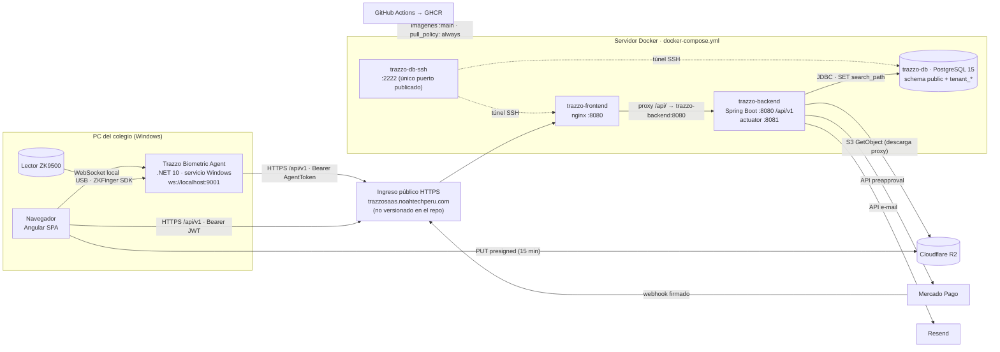

# Auditoría general de Trazzo — conexiones backend · frontend · middleware · OpenAPI · Docker/CI

| | |
|---|---|
| **Fecha** | 2026-10-22 |
| **Base auditada** | `main` @ `6cd4015` (rama `fix/remake-trazzo`, idéntica a `main`) |
| **Ramas revisadas además** | `fix/d02-a-infra-env`, `fix/d02-b-app-config`, `fix/d02-c-tenant-flyway`, `feature/web-cam`, `fix/trazzo`, `fix/horario`, `fix/tenant/directorio-personal`, `feature/audit-conexion` |
| **Tipo** | Solo auditoría. No se modificó código; las pruebas se ejecutaron sobre copias efímeras fuera del repo. |
| **Remediación** | Plan de acción del §13 ejecutado en las ramas `fix/plan-a…f` (sin integrar en `main`); estado por hallazgo en el [§12](#12-registro-consolidado-de-hallazgos) |
| **Alcance** | `back/` (Spring Boot 3.5.14, Java 21), `front/` (Angular 21, pnpm 11.7), `middleware/` (.NET 10, servicio Windows), 5 especificaciones OpenAPI, 3 `docker-compose*.yml`, Dockerfiles, `nginx.conf`, 10 workflows de GitHub Actions |

**Leyenda de severidad:** 🔴 Crítico (rompe un flujo central o es un fallo de seguridad grave) · 🟠 Alto · 🟡 Medio · 🔵 Bajo / documentación.
**Leyenda de estado:** ✅ verificado y correcto · ❌ verificado y roto · ⚠️ funciona con reservas · ⏳ corregido en una rama sin integrar · ℹ️ no verificable en esta auditoría.

---

## Índice

1. [Resumen ejecutivo](#1-resumen-ejecutivo)
2. [Metodología y verificaciones ejecutadas](#2-metodología-y-verificaciones-ejecutadas)
3. [Mapa de conexiones](#3-mapa-de-conexiones)
4. [Historial de fixes y su estado actual](#4-historial-de-fixes-y-su-estado-actual)
5. [Backend](#5-backend)
6. [Frontend](#6-frontend)
7. [Middleware biométrico](#7-middleware-biométrico)
8. [Contrato OpenAPI](#8-contrato-openapi)
9. [Docker, YAML y CI/CD](#9-docker-yaml-y-cicd)
10. [Pruebas de humo en un stack efímero](#10-pruebas-de-humo-en-un-stack-efímero)
11. [Ramas con trabajo sin integrar](#11-ramas-con-trabajo-sin-integrar)
12. [Registro consolidado de hallazgos](#12-registro-consolidado-de-hallazgos)
13. [Plan de acción](#13-plan-de-acción)
14. [Anexos](#14-anexos)

---

## 1. Resumen ejecutivo

**Lo que está bien.** Las tres bases de código compilan y sus suites pasan: backend **2 671 tests (0 fallos, 12 omitidos)**, frontend **1 645/1 645** con **95,8 % de sentencias / 87,8 % de ramas** cubiertas, middleware **340/340**. Las **147 llamadas HTTP del frontend existen en el backend** con el mismo método y ruta, los tipos de mensaje WebSocket front↔middleware coinciden, los tres `docker-compose*.yml` son sintácticamente válidos, los nombres de imagen que publica CI coinciden con los que consume producción, y fixes de seguridad importantes siguen vigentes (JWT *fail-closed*, webhook de Mercado Pago firmado y cerrado por defecto, evidencias R2 privadas con descarga proxy).

**Lo que no funciona hoy.** Que los tests estén verdes no significa que las integraciones funcionen: varios defectos solo aparecen al cruzar componentes.

1. 🔴 **La cadena biométrica no funciona de punta a punta**, ni con el middleware de `main` ni con el de `feature/web-cam`. Se comprobó contra el backend en ejecución: toda marcación cifrada como lo hace .NET recibe `400 "Error descifrado biométrico: Padding error in decryption"`. Hay cuatro causas independientes:
   - **Backend:** RSA-OAEP con MGF1-SHA1 por defecto de Java, frente a MGF1-SHA256 de .NET ([AUD-01](#aud-01)).
   - **Backend:** clave RSA que se regenera en cada arranque, de modo que las huellas enroladas quedan indescifrables tras cada despliegue ([AUD-02](#aud-02)).
   - **Middleware de `main`:** no sabe leer la clave PEM ([AUD-03](#aud-03)).
   - **Middleware de `main`:** cifra sin el AAD que exige el backend ([AUD-04](#aud-04)).
2. 🔴 **Control de acceso roto dentro del tenant.** Solo 19 de 179 endpoints tienen `@PreAuthorize`. Se comprobó en vivo que un usuario con el rol mínimo `usuario` puede listar todos los usuarios, roles y asistencias del tenant, y **crear permisos** (`201`) ([AUD-05](#aud-05)).
3. 🟠 **Correctitud funcional:**
   - La tardanza se calcula comparando la hora **UTC** de captura con el horario **local** del colegio: un ingreso a las 07:55 en Lima se registra como 12:55 ([AUD-07](#aud-07)).
   - El listado de incidencias devuelve las de todo el tenant si el cliente omite `scope=SELF` ([AUD-08](#aud-08)).
4. 🟠 **Infraestructura y configuración:**
   - El `docker-compose.local.yml` falla en un arranque limpio, porque el backend arranca antes que Postgres y no se reinicia ([AUD-10](#aud-10)).
   - La migración V2 de tenant falla en **cada** arranque ([AUD-11](#aud-11)).
   - Los correos SaaS salen sin remitente en producción ([AUD-12](#aud-12)).
   - CI publica imágenes `:main` sin esperar a que los tests pasen ([AUD-13](#aud-13)).
   - El acceso público a producción (dominio, TLS, webhooks) **no está versionado**: el compose solo publica SSH ([AUD-09](#aud-09)).
5. 🟡 **El contrato OpenAPI no es fuente de verdad:**
   - 33 endpoints reales no están documentados y 25 documentados no existen.
   - El `server` apunta a un dominio que no es el de producción.
   - Exige un header `X-Tenant-ID` que el backend ignora.
   - No fija los parámetros criptográficos, y esa ambigüedad está en la raíz del punto 1 ([AUD-16](#aud-16)).
6. ⏳ **Ya hay correcciones escritas pero sin integrar.** Las ramas **D02-A/B/C** (14-oct) corrigen AUD-10, AUD-11 y AUD-12 del punto 4, pero no tocan el OpenAPI, el gate de CD ni el ingreso público. `feature/web-cam` corrige AUD-03 y AUD-04 en el middleware, pero no AUD-01 ni AUD-02, que son del backend.

### Semáforo por componente

| Componente | Build / tests | Integración real | Seguridad | Configuración / despliegue | Documentación |
|---|---|---|---|---|---|
| Backend | ✅ 2 671 tests | ❌ biometría · ⚠️ resto OK | ❌ RBAC tenant | ⚠️ (D02-B/C pendientes) | ⚠️ |
| Frontend | ✅ 1 645 tests, build OK | ✅ 147/147 rutas existen | ⚠️ JWT en localStorage | ✅ | ⚠️ AGENTS.md |
| Middleware | ✅ 340 tests | ❌ PEM/AAD en `main` | ⚠️ token de agente | ⚠️ orígenes/dominios | ⚠️ |
| OpenAPI | ✅ YAML válido, 0 `$ref` rotos | ❌ 33 sin documentar / 25 fantasma | ⚠️ esquema de seguridad incorrecto | — | ⚠️ 5 archivos, 2 versiones |
| Docker / CI | ✅ compose válido | ❌ arranque local en frío | ⚠️ `:latest`, env compartido | ⚠️ ingreso público no versionado | ⚠️ sin `.env.example` en `main` |

---

## 2. Metodología y verificaciones ejecutadas

Todo lo marcado ✅/❌ en este documento se verificó leyendo el código **y**, cuando fue posible, ejecutándolo. Comandos y resultados:

| Verificación | Comando | Resultado |
|---|---|---|
| Tests backend | `cd back && ./mvnw -B test` | ✅ `Tests run: 2671, Failures: 0, Errors: 0, Skipped: 12` — BUILD SUCCESS (1:50 min) |
| Instalación frontend | `cd front && pnpm install --frozen-lockfile` | ✅ (pnpm 11.7.0 vía `packageManager`) |
| Build frontend | `pnpm build` | ✅ bundle inicial 1,74 MB (282 kB transferidos); ⚠️ 4 avisos NG8102 (Facturas, Planes) |
| Tests frontend | `pnpm test` (Karma + ChromeHeadless) | ✅ `Executed 1645 of 1645 SUCCESS`; cobertura: sentencias 95,82 %, ramas 87,81 %, funciones 95,07 %, líneas 96,61 % |
| Tests middleware | `dotnet test middleware/Trazzo.Middleware.slnx` | ✅ `Superado: 340, Omitido: 0` |
| Sintaxis compose | `docker compose -f <archivo> config -q` (con `.env` ficticio) | ✅ los 3 archivos |
| Contratos OpenAPI | parseo con js-yaml + verificación de `$ref` internos y `operationId` | ✅ 5/5 parsean, 0 `$ref` rotos, 0 `operationId` duplicados |
| Cruce de rutas | extracción automática de los 179 `@*Mapping`, las 146 llamadas `HttpClient` del front y las 185 operaciones OpenAPI | ver [§8](#8-contrato-openapi) y [Anexo A](#anexo-a--matriz-de-conexiones-por-endpoint) |
| Interoperabilidad criptográfica | programa Java (réplica exacta de `RsaKeyProviderAdapter` + `MarkAttendanceUseCase`) contra programa .NET (réplica de `HybridCryptographyService`) | ❌ ver [AUD-01](#aud-01)…[AUD-04](#aud-04) |
| Stack efímero | copia de `docker-compose.local.yml` con puertos/nombres alterados, build real de ambas imágenes, seeders del perfil `local` | ver [§10](#10-pruebas-de-humo-en-un-stack-efímero); desmontado al terminar (`down -v --rmi local`) |
| Imagen base del backend | `docker run eclipse-temurin:21-jre sh -c 'command -v curl'` | ✅ `/usr/bin/curl` presente (el healthcheck de compose funciona hoy) |

**No verificado (requiere entornos que no están en el repo):** lector ZK9500 físico, bucket R2 real (incluida su política CORS), cuentas reales de Mercado Pago y Resend, servidor de producción y su ingreso público.

---

## 3. Mapa de conexiones



### Matriz de conexiones

| # | Origen → destino | Protocolo / ruta | Autenticación | Dónde se configura | Estado | Hallazgos |
|---|---|---|---|---|---|---|
| C1 | Navegador → nginx | HTTPS; `/` (SPA) y `/api/v1/*` | — / `Authorization: Bearer` | [`front/nginx.conf`](front/nginx.conf), `API_BASE_URL='/api/v1'` en [`app.config.ts:24-27`](front/src/app/app.config.ts#L24-L27) | ✅ probado (200, deep-link a `/tenant/dashboard` 200) | AUD-09 |
| C2 | nginx → backend | HTTP `trazzo-backend:8080` (resolver Docker `127.0.0.11`) | reenvía el header | [`nginx.conf:29-43`](front/nginx.conf#L29-L43) | ✅ probado | — |
| C3 | `ng serve` → backend (dev) | proxy `/api` → `localhost:8080` | Bearer | [`front/proxy.conf.json`](front/proxy.conf.json) | ✅ config | AUD-18 (ya no hay mock) |
| C4 | Backend → PostgreSQL | JDBC; schema por tenant vía `SET search_path` | `DB_USER`/`DB_PASSWORD` | [`application.properties:11-14`](back/src/main/resources/application.properties#L11-L14), compose | ✅ prod · ❌ arranque local en frío | AUD-10, AUD-11 |
| C5 | Navegador → middleware | `ws://localhost:9001/` | lista de `Origin` permitidos | [`middleware-websocket.service.ts:145`](front/src/app/services/middleware-websocket.service.ts#L145), `Agent:AllowedOrigins` | ⚠️ | AUD-14 |
| C6 | Middleware → backend | HTTPS: `GET /security/public-key`, `POST /asistencia/marcar`, `POST /asistencia/sync`, `GET /corehr/biometria/enroll/pendiente`, `POST /corehr/biometria/enroll/completar` | `Bearer <Queue:AgentToken>` + `X-Tenant-ID` (el backend lo ignora) | [`appsettings.json`](middleware/Trazzo.Biometric.Agent/appsettings.json), [`Configure-Agent.ps1`](middleware/Trazzo.Biometric.Agent/scripts/Configure-Agent.ps1) | ❌ | AUD-01…06 |
| C7 | Navegador → R2 | HTTPS `PUT` a URL prefirmada | firma S3 | [`StorageController.java:28-50`](back/src/main/java/trazzo/back/shared/infrastructure/adapters/in/web/StorageController.java#L28-L50) | ℹ️ (requiere bucket y CORS del bucket) | AUD-26 |
| C8 | Backend → R2 | S3 `GetObject` (descarga proxy) | access key | `cloudflare.r2.*` | ℹ️ · ✅ cae a `LocalStorageStub` si no hay endpoint | — |
| C9 | Backend ↔ Mercado Pago | API preapproval + webhook `x-signature` | token / HMAC del SDK oficial | [`MercadoPagoWebhookController.java:64-72`](back/src/main/java/trazzo/back/saasglobal/infrastructure/adapters/in/web/MercadoPagoWebhookController.java#L64-L72) | ✅ código · ℹ️ sin cuenta real | AUD-09 |
| C10 | Backend → Resend | HTTPS API | API key | [`ResendEmailAdapter.java:30`](back/src/main/java/trazzo/back/saasglobal/infrastructure/adapters/out/email/ResendEmailAdapter.java#L30) | ❌ remitente vacío en prod | AUD-12 |
| C11 | CI → GHCR → servidor | `build-push` con tag `:main`; `pull_policy: always` | `GITHUB_TOKEN` | [`publish-docker.yml`](.github/workflows/publish-docker.yml), [`docker-compose.yml:49,77`](docker-compose.yml#L49) | ✅ nombres coinciden · ⚠️ sin gate de CI | AUD-13 |
| C12 | Healthchecks | `pg_isready`; `curl :8081/actuator/health` | — | [`docker-compose.yml:19,70`](docker-compose.yml#L19) | ✅ probado (`{"status":"UP"}`) | AUD-24 |
| C13 | Operador → red interna | SSH `:2222` con túnel | llave pública, sin contraseña | [`docker-compose.yml:25-45`](docker-compose.yml#L25-L45) | ✅ | AUD-24 |

---

## 4. Historial de fixes y su estado actual

El historial se reconstruyó de los 61 commits de `main` (todos *squash merges*) y de las ramas sin integrar. La columna **Estado hoy** es el resultado de verificar cada fix contra el código actual o ejecutándolo.

| Fecha | PR / commit | Área | Fixes principales | Estado hoy (22-oct) |
|---|---|---|---|---|
| may–jun | `ee34316`, `1ef7f31`, #16, #17, #28 | CI | Configuración inicial de Actions (CI front/back, seguridad, commitlint) | ✅ 10 workflows activos |
| 10-jun | #27 | Middleware | Middleware v2 (WS, ZKTeco, cola) y `PLAN_DE_PRUEBAS.md` | ✅ base vigente |
| jun | #49, #58, #61 | Front | Corrección en producción, dependencias de Dependabot | ✅ |
| 27-jun | #68 | Back/reports | Conversión de tipos, datos de identidad reales, `LATERAL JOIN` para roles | ✅ tests verdes |
| 28-jun | #55, #70 | Back/incidents | Seeder, errores de incidencias, hallazgos de Qodo | ✅ tests verdes |
| 28-jun | #64 | Back/saasglobal | `HoldingType` PUBLICO/PRIVADO, error ante tipo desconocido | ✅ tests verdes |
| 29-jun | #65 | Back/corehr | “Auditoría arquitectónica, persistencia robusta y alineación OpenAPI” | ⚠️ el OpenAPI volvió a divergir ([§8](#8-contrato-openapi)) |
| 29-jun | #69 | Front | Mock de API, carga de vistas, Sonar/Qodo | ⚠️ el mock se desregistró el 25-jul (#107); la documentación no se actualizó (AUD-18) |
| 30-jun | #75 | Infra | Login en prod, SSH + BD en Docker, fix de nginx | ✅ `proxy_pass` con variable y resolver (probado) |
| 30-jun – 1-jul | `3a02c03`, #76, #79 | CI/Front | `master` → `main`; renombre `sass` → `saas` | ✅ |
| 1-jul | #66 | Docs | Contratos OpenAPI SaaS/organization/reports/audit | ⚠️ 5 archivos separados y desalineados (AUD-16) |
| 1-jul | #81, #83 | Infra | Acceso por túnel SSH, se quitan puertos de front/back, `pull_policy: always` | ⚠️ el ingreso público quedó fuera del repo (AUD-09) |
| 1–2-jul | #82, #84, #85 | Back | API bajo `context-path=/api/v1`, actuator relativo, healthcheck | ✅ `{"status":"UP"}` en `:8081` |
| 2-jul | #63, #80 | Middleware | SQLite, Sonar, parches del contrato v1…v8 | ❌ contrato criptográfico incompatible (AUD-01…04) |
| 2-jul | #60 | Middleware | `SourceGear.sqlite3` por GHSA-2m69-gcr7-jv3q | ✅ 3.50.4.5 en el `.csproj` |
| 7-jul | #86 | Back/security | JWT *stateless*, *hardening*, secretos fuera del repo, gitleaks | ✅ |
| 7-jul | #74 | Back/organization | Validación de padre activo, persistencia endurecida | ✅ tests verdes |
| 9-jul | #93 | Back/Front | Rol admin = `admin_trazzo`, bug `bytea` con búsqueda nula, `finalName=app` | ✅ [`pom.xml:189`](back/pom.xml#L189), [`UserDetailsServiceImpl.java:36`](back/src/main/java/trazzo/back/saasglobal/infrastructure/security/UserDetailsServiceImpl.java#L36) |
| 11-jul | #98 | Back | UUID para tenant/usuario; R2 opcional | ✅ `LocalStorageStub` si no hay endpoint |
| 11-jul | #87 | Front/Middleware | Conexión al huellero por WS, notificaciones por rol | ✅ los tipos de mensaje coinciden |
| 13-jul | #104 | CI | pnpm en CI | ✅ pnpm 11.7.0 fijado |
| 17-jul | #110 | Back/Front (pagos + tenancy) | Cast `currency_enum`; multitenancy por schema; cuelgue de H2 en CI; aislamiento de tenant; Mercado Pago (webhook con reintento y firma); rollback de trial; escape HTML en correos; `seed.admin=false` fuera de local; actuator sin detalle anónimo; *lock* de suscripción; purga de trials | ✅ verificados: [`PlanJdbcRepositoryAdapter.java:26`](back/src/main/java/trazzo/back/saasglobal/infrastructure/adapters/out/persistence/PlanJdbcRepositoryAdapter.java#L26), [`RequestService.java:64`](back/src/main/java/trazzo/back/saasglobal/application/usecase/RequestService.java#L64), [`application.properties:56,90`](back/src/main/resources/application.properties#L56), webhook *fail-closed*, `FOR UPDATE` en [`TenantPlanSubscriptionService.java:70`](back/src/main/java/trazzo/back/saasglobal/application/usecase/TenantPlanSubscriptionService.java#L70) |
| 20-jul | #94 | Back/Front corehr | Fix de auth; marcación y sync biométricos; enrolamiento pendiente; Flyway → `db/master`; script de tenant versionado; Resend `resend.from` | ✅ endpoints existen · ❌ cripto incompatible · ❌ `resend.from` solo existe en el perfil local (AUD-12) |
| 25-jul | #107 | Back/Front incidents + security | IDs enteros; RBAC de tenant (`TenantPermissionPort`, `TenantContextGuard`, `@PreAuthorize` en incidencias); idempotencia de migraciones; login infinito; URL de front para MP; error 500 del motivo de rechazo; evidencias R2 privadas + descarga proxy + `downloadWithAuth`; seeder sin credenciales; `JwtAuthFilter` *fail-closed*; IDOR `scope=SELF` *fail-closed* | ✅ *fail-closed* (token inválido → 401, probado); ✅ descarga proxy; ❌ `TenantContextGuard` no actúa en runtime (AUD-15); ⚠️ RBAC solo en incidencias y con huecos (AUD-05, AUD-08); ❌ V2 sigue fallando (AUD-11) |
| 25-jul | #103 | Front/Back reports + audit | UI de cierres mensuales; métricas de auditoría; `roleGuard`; unique en V2; sin contraseñas fijas; pnpm fijado | ✅ 37 rutas con `authGuard`+`roleGuard`; ❌ V2 falla en cada arranque |
| 14-oct | `3de58a2` (**D02-A**) | Infra | Paridad local/prod en compose, servicio *one-shot* de bootstrap de BD, `.env.example` / `.env.local.example`, healthchecks, TZ=UTC, timeouts de nginx, `*.sh` en LF | ⏳ sin mergear |
| 14-oct | `0532bc4` (**D02-B**) | Back config | Resend `from-email`, `StartupConfigValidator`, MP sandbox/back-url, Hikari, *graceful shutdown*, actuator solo `health` | ⏳ sin mergear |
| 14-oct | `4fd5a6c` (**D02-C**) | Back migraciones | Flyway por tenant (`flyway_tenant_history`), `V3` → `V3_1`, V2 acotada a `current_schema()`, health `tenantMigrations`, Testcontainers | ⏳ sin mergear |
| jul–22-oct | `feature/web-cam` | Middleware (+ back/front/camera) | Clave PEM, AAD `biometric-identify`, `captured_at_utc` sin offset, padrón local 1:N, script de *Local Network Access*, módulo `camera/` | ⏳ sin mergear (25 commits, 3 por detrás de `main`) |

> **Corrección a una nota previa del equipo.** Hasta el 18-jul el backend usaba `template_cifrado` / `llave_cifrado` / `capturado_en`. Desde #94 (20-jul), `POST /corehr/biometria/enroll/completar` usa `CompleteEnrollHttpRequest` con `encrypted_template_base64`, `encrypted_aes_key_base64`, `iv_base64`, `tag_base64` y `captured_at_utc`, igual que el OpenAPI y que el middleware. Además, los 4 endpoints que faltaban (`/security/public-key`, `/asistencia/marcar`, `/asistencia/sync`, `/enroll/pendiente`) **ya existen** en `main`. El DTO `CompleteEnrollRequest` (`*_cifrado`) quedó como código muerto.

---

## 5. Backend

### 5.1 Inventario

| Módulo | Clases main | Clases test | Endpoints | Con `@PreAuthorize` |
|---|---|---|---|---|
| `saasglobal` (auth, SaaS, tenants, pagos, solicitudes) | 209 | 84 | 61 | 4 (las de `/saas/invoices`, anotación de clase) |
| `corehr` (personal, horarios, dispositivos, biometría, asistencia) | 228 | 157 | 54 | 0 |
| `organization` (sedes, áreas, departamentos, roles, permisos, facturación) | 94 | 28 | 32 | 0 |
| `incidents` | 78 | 44 | 15 | 9 |
| `audit` | 83 | 61 | 11 | 5 (más la regla de URL `SAAS_ADMIN`) |
| `reports` | 43 | 37 | 5 | 0 |
| `shared` (seguridad, tenancy, storage) | 21 | 17 | 1 | 1 |
| `notifications` | 0 | 0 | — | paquete vacío |
| **Total** | **757** | **429** | **179** | **19** |

### 5.2 Configuración

| Propiedad | Valor / variable | Observación |
|---|---|---|
| `server.servlet.context-path` | `/api/v1` | ✅ coherente con nginx, front, middleware y OpenAPI |
| `management.server.port` | `8081`, expone `health,info` | ✅ el healthcheck de compose funciona · ⚠️ `info` expuesto sin necesidad (D02-B lo quita) |
| `app.encryption.key` | `${APP_ENCRYPTION_KEY}` **sin valor por defecto** | 🟡 si falta en `.env`, el arranque falla con un error genérico de *placeholder* (D02-B añade `StartupConfigValidator`) |
| `app.jwt.secret` / `expiration-ms` | `${APP_JWT_SECRET}` / `86400000` (24 h) | ⚠️ 24 h sin refresh: impacta al agente biométrico (AUD-06) |
| `spring.datasource.*` | `DB_URL`, `DB_USER` (por defecto `trazzo_app`), `DB_PASSWORD` (obligatoria) | ✅ |
| `spring.flyway.locations` | `classpath:db/master` | ✅ (fix #94) |
| `spring.session.jdbc.initialize-schema` | `never` | 🔵 configuración muerta: no hay dependencia de Spring Session |
| `app.frontend-url` | `${FRONTEND_URL:https://trazzosaas.noahtechperu.com}` | 🟡 dominio de prod fijo como valor por defecto (D02-B lo hace obligatorio fuera de local) |
| `resend.from-email` vs `resend.from` | la base define `from-email`; `ResendEmailAdapter` lee `resend.from` | 🟠 AUD-12 |
| `cloudflare.r2.*` | vacías por defecto → `LocalStorageStub` | ✅ |
| `mercadopago.*` | vacías por defecto; webhook rechaza todo si no hay secreto | ✅ |
| Perfil `local`: datasource por defecto | `localhost:5432/trazzo_dev_db`, `trazzo_dev`/`trazzo_dev_pass` | 🔵 `docker-compose.dev.yml` publica esa BD en el puerto **5433**: sin `DB_URL` no conecta |

### 5.3 Seguridad y multitenancy

- ✅ **JWT *stateless*** leído solo de `Authorization: Bearer` ([`JwtAuthFilter.java:54`](back/src/main/java/trazzo/back/shared/security/JwtAuthFilter.java#L54)). Todo camino de fallo limpia `TenantContext` y `SecurityContext` y responde 401 (L83-107; probado: token inválido → 401). El *claim* de tenant se lee después de verificar la firma (L65-75).
- ✅ **Tenant por *claim* JWT** y `SET search_path` por conexión. **El header `X-Tenant-ID` no se lee en ningún punto del backend**, aunque el OpenAPI lo exige y el middleware lo envía.
- ✅ **Reglas por URL** ([`SecurityConfig.java:86-98`](back/src/main/java/trazzo/back/shared/security/SecurityConfig.java#L86-L98)): públicos `/auth/login`, `/security/public-key`, `/error`, `/requests`, `/public/plans`, `/shop/checkout`, `/webhooks/mercadopago` y `/actuator/health`; `/saas/**`, `/tenants/**`, `/audit/**` y `/actuator/**` exigen `ROLE_SAAS_ADMIN` (solo `admin_trazzo`); el resto exige autenticación.
- ❌ **Sin autorización por permiso fuera de incidencias** (AUD-05): ver el conteo de §5.1 y la prueba en vivo de §10.
- ❌ **`TenantContextGuard` inactivo en runtime** (AUD-15): un admin SaaS que llama a `GET /corehr/devices` recibe **500 `relation "device" does not exist`** en lugar de 403. Como `TenantContext.get()` devuelve `"public"` por defecto ([`TenantContext.java:20-23`](back/src/main/java/trazzo/back/shared/tenancy/TenantContext.java#L20-L23)), si el guard estuviera registrado habría respondido 403. La causa más probable es `@ConditionalOnBean(DataSource.class)` en una `@Configuration` de usuario ([`SecurityConfig.java:58-62`](back/src/main/java/trazzo/back/shared/security/SecurityConfig.java#L58-L62)): Spring Boot solo garantiza ese condicional en auto-configuraciones, y el `DataSource` aún no existe cuando se evalúa. No hay tablas con el mismo nombre en `public` y en los schemas de tenant, así que el impacto se limita a errores 500.
- ✅ **Webhook de Mercado Pago:** usa el validador del SDK oficial y rechaza todo con 401 si no hay secreto configurado.
- ✅ **CSRF desactivado** con justificación (API *stateless* con Bearer). **CORS no configurado**: correcto mientras el front se sirva por el mismo origen (nginx/proxy). Las subidas directas a R2 requieren configurar CORS **en el bucket**.

### 5.4 Biometría (corehr)

| Paso | Endpoint | DTO (JSON) | Estado |
|---|---|---|---|
| Clave pública | `GET /security/public-key` (público, caché 300 s) | `{ publicKey (PEM), kid }` | ✅ responde · ❌ clave efímera (AUD-02) |
| Iniciar enrolamiento | `POST /corehr/biometria/enroll/iniciar` (front) | `tenant_user_id`, `device_id`, `finger_index` | ✅ · ⚠️ sesiones en memoria (AUD-22) |
| Pendiente | `GET /corehr/biometria/enroll/pendiente?device_code=` (middleware) | `enroll_token`, `device_id`, `device_code`, … | ✅ |
| Completar | `POST /corehr/biometria/enroll/completar` (middleware) | `CompleteEnrollHttpRequest` (`encrypted_*_base64`, `iv_base64`, `tag_base64`, `captured_at_utc`) | ⚠️ guarda el blob sin descifrarlo: un payload indescifrable se acepta con `201` y falla después, al marcar |
| Marcar | `POST /asistencia/marcar` | `BiometricIdentifyRequest` | ❌ `400 Padding error in decryption` (probado) |
| Sincronizar | `POST /asistencia/sync` (lote) | `List<BiometricIdentifyRequest>` → `202` | ❌ misma causa; además toma `tenant_user_id` del primer elemento del cuerpo ([`AttendanceSyncController.java:57-60`](back/src/main/java/trazzo/back/corehr/infrastructure/adapters/in/web/AttendanceSyncController.java#L57-L60)) |

Detalles relevantes:

- El *matching* 1:N carga hasta **10 000** plantillas y descifra **cada una con RSA en cada marcación** ([`MarkAttendanceUseCase.java:55`](back/src/main/java/trazzo/back/corehr/application/usecase/MarkAttendanceUseCase.java#L55), [`SourceAfisMatchingAdapter.java:68-99`](back/src/main/java/trazzo/back/corehr/infrastructure/adapters/out/biometric/SourceAfisMatchingAdapter.java#L68-L99)). El costo crece linealmente con el padrón, y una plantilla que no se puede descifrar se ignora en silencio (`return null` con log `debug`).
- La fecha y la tardanza se calculan sobre `captured_at_utc` sin zona horaria ([`Attendance.java:140-150`](back/src/main/java/trazzo/back/corehr/domain/model/attendance/Attendance.java#L140-L150)); no existe `ZoneId` en todo corehr (AUD-07).

### 5.5 Migraciones

- **Master** (`db/master`, Flyway): V1…V9 con historial. ✅
- **Tenant**: el *bootstrap* `db/tenant/V1__tenant_db.sql` se aplica al aprovisionar. Las migraciones `db/tenant/migration/*.sql` las ejecuta `TenantSchemaMigrator` **completas en cada arranque y para cada tenant, sin historial**; los errores solo se registran en el log ([`TenantSchemaMigrator.java:94-108`](back/src/main/java/trazzo/back/saasglobal/infrastructure/adapters/out/provisioning/TenantSchemaMigrator.java#L94-L108)). Consecuencias, verificadas en el stack efímero:
  - `V2__monthly_closures_constraints.sql` **falla en cada arranque** (`Failed to execute SQL script statement #2 … DO $$`): `ScriptUtils` parte los bloques `DO $$` por `;`. Además, sus consultas a `information_schema` no filtran por schema ([`V2…sql:9-34`](back/src/main/resources/db/tenant/migration/V2__monthly_closures_constraints.sql#L9-L34)), así que en una BD con varios tenants pueden “ver” la tabla de otro.
  - Dos scripts `V3__…` (`align_incidents_schema` y `seed_default_roles_permissions`); el orden depende del nombre del archivo.
  - El comentario de V2 dice “V4 re-applies these same guards”, pero V4 hoy trata de columnas de asistencia.
  - **D02-C** sustituye todo esto por Flyway por tenant.

### 5.6 Tests

- 12 omitidos: 10 *placeholders* de corehr con `@Disabled("TODO: El desarrollador asignado debe implementar…")` y `TenantControllerTest` (2), de modo que `POST /tenants/trial` no tiene test de capa web.
- Los tests de cripto **cifran con Java usando la misma transformación** con la que descifran ([`MarkAttendanceUseCaseTest.java:66,86`](back/src/test/java/trazzo/back/corehr/application/usecase/MarkAttendanceUseCaseTest.java#L66)). Por eso son simétricos y no detectan AUD-01: falta un vector de prueba generado por .NET.

---

## 6. Frontend

| Aspecto | Hallazgo | Estado |
|---|---|---|
| URL base | `API_BASE_URL = '/api/v1'` ([`app.config.ts:24-27`](front/src/app/app.config.ts#L24-L27)); no hay `environments/` | ✅ relativa: sirve igual tras nginx o tras el proxy de `ng serve` |
| Interceptores | solo `authInterceptor` ([`main.ts:12`](front/src/main.ts#L12)): añade Bearer salvo en `/auth/login`, `/security/public-key` y orígenes externos (R2); ante un 401 borra el token y redirige a `/login` | ✅ |
| Mock | `mockInterceptor` existe y tiene tests, pero **no está registrado** desde #107 | ⚠️ AGENTS.md dice lo contrario (AUD-18) |
| Cobertura de rutas | 147 combinaciones método+ruta llamadas → **todas existen en el backend** (0 rotas) | ✅ |
| Sin uso desde el front | `POST /incidentes/{id}/notificar`, `/justificar`, `GET /incidentes/tipos/{id}`, CRUD de `/saas/features` y `/saas/holdings` (salvo listar), `GET /audit/{login-history,sessions,system-audit,tenant-settings}`, `GET /auth/me`, `PATCH /corehr/biometria/{id}`, `PATCH /corehr/tenant-contacts/{id}`, `GET /org/roles/{id}/users`, `GET` por id de `org/*` | ℹ️ funcionalidad de backend sin pantalla |
| Rutas y guards | 37 rutas; las protegidas usan `authGuard` + `roleGuard` (admin-saas / admin-tenant / usuario según permisos del login) | ✅ |
| Token | `localStorage['trazzo_token']`, 24 h, sin refresh ([`auth.interceptor.ts:23`](front/src/app/api/auth.interceptor.ts#L23)) | 🟡 expuesto a XSS (AUD-20) |
| Descargas | `downloadWithAuth` añade Bearer y `credentials:'include'` ([`download.ts:8-12`](front/src/app/shared/storage/download.ts#L8-L12)) | ✅ |
| Subida a R2 | `getPresignedUrl` → `PUT` directo (sin Bearer, origen externo) → `POST /incidentes/{id}/evidencias` con `file_key` | ✅ el contrato `presigned_url`/`object_key` coincide con el backend |
| Validación de archivos | lista blanca de MIME + *magic bytes*; incluye la regla MZ (`application/x-msdownload`) | ✅ |
| WebSocket | `ws://localhost:9001/` fijo; envía `device.status`, `fingerprint.capture`, `.identify`, `.enroll.start`, `.enroll.cancel` | ✅ el middleware maneja los 5 tipos · ⚠️ orígenes (AUD-14) |
| Build | 4 avisos NG8102 (`??` innecesario en Facturas y Planes) | 🔵 |
| Docker | `node:24-alpine` + `pnpm install --frozen-lockfile --ignore-scripts` + `pnpm rebuild` de binarios nativos → `nginx:alpine` sin root en `:8080`; tiene `.dockerignore` | ✅ build probado |

---

## 7. Middleware biométrico

| Aspecto | `main` | `feature/web-cam` |
|---|---|---|
| Framework / empaquetado | .NET 10 (`net10.0-windows`, `win-x64`), servicio Windows, MSI WiX v4 | igual |
| `Backend:BaseUrl` | `""`: cifrado, cola y marcación **inactivos** hasta configurar | `https://trazzosaas.noahtechperu.com/api/v1` |
| `Agent:AllowedOrigins` | `[]`: solo acepta orígenes *loopback* | `["https://trazzosaas.noahtechperu.com"]` |
| Lectura de la clave pública | `Convert.FromBase64String(publicKey)` → ❌ **`FormatException` con el PEM del backend** ([`HybridCryptographyService.cs:132-139`](middleware/Trazzo.Biometric.Agent/Security/HybridCryptographyService.cs#L132-L139)) | ✅ acepta PEM (`ImportFromPem`) y Base64 |
| AES-256-GCM | ❌ sin AAD ([`HybridCryptographyService.cs:90-93`](middleware/Trazzo.Biometric.Agent/Security/HybridCryptographyService.cs#L90-L93)) | ✅ AAD `biometric-identify` |
| RSA | `OaepSHA256` (MGF1-SHA256) | igual → ❌ incompatible con el backend actual (AUD-01) |
| `captured_at_utc` | formato `"O"` con `Z` (Jackson lo convierte a UTC) | `yyyy-MM-ddTHH:mm:ss.fff` en UTC, sin offset |
| Nombres de campos | `encrypted_template_base64`, `encrypted_aes_key_base64`, `iv_base64`, `tag_base64`, `captured_at_utc`, `device_code` | ✅ iguales al backend |
| Autenticación con el backend | `Bearer <Queue:AgentToken>` (DPAPI) + `X-Tenant-ID` | igual (AUD-06) |
| Tests | 340 ✅ (la documentación dice 262) | — |

Pendientes que ya declara [`README-dev-handoff.md`](middleware/docs/README-dev-handoff.md):

- Publicar el MSI y el manifiesto de auto-update en una URL estable.
- Firmar el MSI.
- Definir cómo se configura `appsettings.json` por tenant.
- Decidir si el WebSocket devuelve el resultado del backend.

A eso se suman dos detalles:

- `Configure-Agent.ps1` usa por defecto los dominios `https://app.trazzo.pe` / `https://api.trazzo.pe/api/v1`, que no son los de producción.
- `BiometricList` y `StartEnrollment` están configurados pero no se usan.

---

## 8. Contrato OpenAPI

| Archivo | Versión OAS | Ops | Seguridad declarada | `servers` |
|---|---|---|---|---|
| `openapi.yaml` | 3.0.3 | 93 | `bearerAuth` **+ `tenantHeader` (`X-Tenant-ID`) global** ([L47-50](openapi.yaml#L47-L50), [L3330-3332](openapi.yaml#L3330-L3332)) | `https://api.trazzo.pe/api/v1` |
| `openapi-organization.yaml` | 3.1.0 | 43 | `bearerAuth` | ídem |
| `openapi-saas.yaml` | 3.1.0 | 33 | `bearerAuth` | ídem |
| `openapi-reports.yaml` | 3.1.0 | 5 | `bearerAuth` | ídem |
| `apicontractoAudit.yaml` | 3.1.0 | 11 | **ninguna** (el backend exige `SAAS_ADMIN`) | ídem |

**Cruce con el backend (179 operaciones reales; 171 únicas documentadas):** 146 coinciden, **33 existen sin documentar** y **25 están documentadas pero no existen**. El detalle está en el [Anexo A](#anexo-a--matriz-de-conexiones-por-endpoint).

- **Sin documentar:** todo `/saas/tenants/*`, `/saas/roles/*`, `/saas/invoices/*` (incluidas las exportaciones), `/saas/requests/*`, `/saas/subscriptions`, `/org/billing/*`, `/public/plans`, `/shop/checkout`, `POST /requests`, `/webhooks/mercadopago`, `PUT /saas/users/{id}/roles`, `PATCH /saas/users/me` y `POST /org/roles/{id}/permissions`.
- **Fantasma:** `openapi-saas.yaml` documenta `/tenants/*` y `/subscriptions/*`, que en el backend viven bajo `/saas/…`; los `activate/deactivate` de sedes, áreas y departamentos; `/org/users/{id}/departments` (en el backend es `/corehr/usuarios/{id}/departamentos`); `POST /org/roles/{id}/permissions/{permissionId}` (en el backend es un `POST` con cuerpo); y `GET /ws/incidents` y `/ws/corehr` (no hay WebSocket en el backend).

**Desalineaciones de contenido:**

- El `server` apunta a `api.trazzo.pe`; producción es `trazzosaas.noahtechperu.com`.
- `X-Tenant-ID` figura como obligatorio, pero el tenant viaja en el JWT.
- `UsuarioResponse.tenant_permissions` (añadido en #107) no aparece.
- Hay 37 menciones a **Redis**, que no existe en el stack (el enrolamiento usa un `ConcurrentHashMap`).
- `MarcacionRequest` marca `iv_base64`/`tag_base64` como obligatorios, pero no los define en `properties`.
- Se conserva el `CompleteEnrollRequest` legado (`*_cifrado`).
- 🟠 **No se especifican los parámetros criptográficos:** hash y MGF1 de OAEP, AAD, longitud de IV y tag, ni el formato exacto de `captured_at_utc` (UTC o local, con o sin offset). Esa ambigüedad permitió que back y middleware implementaran variantes incompatibles.
- `.42c/conf.yaml` (42Crunch) solo registra `openapi.yaml`, y además está en `.gitignore`.

---

## 9. Docker, YAML y CI/CD

### 9.1 Compose

| Archivo | Uso | Hallazgos |
|---|---|---|
| `docker-compose.yml` (prod) | `trazzo-db` (pg15), `trazzo-db-ssh` (`:2222`), back y front desde GHCR `:main`, `pull_policy: always` | ✅ válido; dependencias con `service_healthy`; healthcheck de back probado. 🟠 **Solo publica `:2222`**: `cloudflared` está comentado ([L88-94](docker-compose.yml#L88-L94)) y el ingreso público no está versionado (AUD-09). 🟡 `PROVISIONING_*` ([L59-63](docker-compose.yml#L59-L63)) no las lee nadie. 🔵 `env_file: .env` inyecta en el backend también la contraseña de superusuario de Postgres. 🔵 `pg_isready -U postgres -d postgres` fijo ([L19](docker-compose.yml#L19)). 🔵 `openssh-server:latest` sin fijar. 🔵 sin rotación de logs ni límites de recursos |
| `docker-compose.local.yml` | build local de back+front, `postgres-local` en `5433` | 🟠 **falla en un arranque limpio** (probado): el backend no tiene `depends_on`/healthcheck sobre Postgres ni `restart`, y muere con `Connection refused`. 🟡 usa el superusuario `postgres/admin` ([L22-23](docker-compose.local.yml#L22-L23)); no monta el script de init. 🟡 `FRONTEND_URL=${FRONTEND_URL:-localhost:4000}` sin esquema ([L36](docker-compose.local.yml#L36)), contradiciendo el comentario de L32-35. 🟡 exige `.env.local` pero no hay plantilla en `main` |
| `docker-compose.dev.yml` | solo Postgres (`trazzo_dev`) | 🔵 usa el puerto `5433`, igual que `local` (no pueden levantarse juntos), y el perfil `local` apunta por defecto a `5432` |

### 9.2 Imágenes

- **Backend:** `eclipse-temurin:21-jdk` → `21-jre`, capas *layered*, usuario sin privilegios, `finalName=app`. ✅ Build probado. 🔵 Falta `back/.dockerignore`, por lo que `target/` viaja en el contexto de build. 🔵 No declara `HEALTHCHECK` propio; usa el de compose.
- **Frontend:** ver §6. ✅
- **Script de init** ([`01-init-master-db.sh`](docker/postgres/init/01-init-master-db.sh)):
  - Solo corre con el volumen vacío.
  - Interpola contraseñas en SQL sin escapar.
  - Está guardado en LF pero se extrae con **CRLF en Windows** (`core.autocrlf=true`, sin regla para `*.sh` en `.gitattributes`), así que falla si se monta desde una copia de Windows.
  - D02-A corrige el primero (servicio *bootstrap* en cada `up`) y el tercero (`*.sh text eol=lf`); el escape de contraseñas sigue pendiente.

### 9.3 Workflows

| Workflow | Disparo | Observación |
|---|---|---|
| `back-ci.yml` | PR a `main` (sin filtro de rutas), push a `back/**` | 🔵 ejecuta `mvn clean verify` **dos veces** (L34 y L41, la segunda con Sonar); usa `mvn` del runner en lugar de `./mvnw` |
| `front-ci.yml` | PR a `main`, push a `front/**` | ✅ Node 24.15.0, pnpm 11.7.0, tests y build de producción |
| `middleware-ci.yml` | PR / push a `middleware/**` | ✅ .NET 10, Sonar, publish y MSI como artefactos |
| `publish-docker.yml` | push a `main` con cambios en `back/**` o `front/**` | 🟠 **no depende del CI**: publica `:main` aunque los tests fallen, y prod hace `pull_policy: always` (AUD-13) |
| `nginx-validate.yml` | cambios en `nginx.conf` / `Dockerfile` del front | ✅ construye y arranca el contenedor |
| `gitleaks`, `dependency-review`, `commitlint`, `stop-merging`, `trazzo-pr-reviewer` | PR / push | ✅ |
| Despliegue | — | ℹ️ no hay workflow de despliegue: el servidor se actualiza fuera del repo |

---

## 10. Pruebas de humo en un stack efímero

Se levantó una **copia** de `docker-compose.local.yml` con los puertos `18080`/`14000`/`15433`, sin `container_name`, con secretos aleatorios y los seeders del perfil `local` (admin SaaS, tenant `demo`, usuario `usuario`). Se construyeron las imágenes reales desde el código actual. Al terminar se eliminaron contenedores, volúmenes, imágenes construidas y las imágenes base descargadas solo para la prueba.

| # | Prueba | Resultado | Esperado | Estado |
|---|---|---|---|---|
| S1 | `docker compose up` desde cero | backend `Exited (1)`: `Connection to postgres-local:5432 refused` (Postgres terminó su init 3 s después) | backend arriba | ❌ AUD-10 |
| S2 | Healthcheck dentro del contenedor (`curl :8081/actuator/health`) | `{"status":"UP"}` | UP | ✅ |
| S3 | `GET /api/v1/public/plans` vía nginx y directo | 200 / 200 | 200 | ✅ |
| S4 | SPA: `/` y deep-link `/tenant/dashboard` | 200 / 200 | 200 | ✅ |
| S5 | `GET /security/public-key` | `kid=key-2026-10-22-220246`, formato **PEM** | — | ✅ (incompatible con el middleware de `main`) |
| S6 | Login admin / demo / usuario | 3 JWT emitidos | OK | ✅ |
| S7 | `demo` → `GET /saas/tenants` | 403 | 403 | ✅ |
| S8 | Token inválido → `GET /usuarios`; anónimo → `GET /corehr/devices` | 401 / 401 | 401 | ✅ |
| S9 | admin SaaS → `GET /corehr/devices` | **500** `relation "device" does not exist` | 403 | ❌ AUD-15 |
| S10 | `usuario` (permisos: `incidencias.crear`, `incidencias.ver-propias`, `perfil.ver-actualizar-datos`, `asistencia-docente.ver-historial`) → `GET /usuarios`, `GET /org/roles`, `GET /corehr/attendance`, `GET /org/billing/plan` | **200, 200, 200, 200** | 403 | ❌ AUD-05 |
| S11 | `usuario` → `POST /org/permissions` | **201 Created** | 403 | ❌ AUD-05 |
| S12 | `usuario` → `GET /incidentes` sin `scope` | 200, `"scopeAplicado": null` (todo el tenant) | 403 o forzar SELF | ❌ AUD-08 |
| S13 | `POST /asistencia/marcar` con cifrado estilo middleware `main` (sin AAD) | **400** `Error descifrado biométrico: Padding error in decryption` | 2xx o “huella no reconocida” | ❌ AUD-01/04 |
| S14 | `POST /asistencia/marcar` con cifrado estilo `feature/web-cam` (con AAD) | **400** `Padding error in decryption` | ídem | ❌ AUD-01 |
| S15 | Reiniciar el backend y volver a pedir la clave | `kid` pasa de `…220246` a `…220306` | estable | ❌ AUD-02 |
| S16 | Migraciones de tenant (2 arranques) | V3, V3, V4 se re-ejecutan; **V2 falla en ambos** | aplicadas una vez | ❌ AUD-11 |

**Prueba aislada de interoperabilidad** (Java replica el backend; .NET replica el middleware):

| Variante del middleware | Backend tal cual (`OAEPWithSHA-256AndMGF1Padding`, MGF1-SHA1 por defecto) | Backend con `OAEPParameterSpec` MGF1-SHA256 |
|---|---|---|
| `main`: `Convert.FromBase64String(PEM)` | `FormatException` (ni siquiera cifra) | — |
| `main`: sin AAD | ❌ `BadPaddingException` | ❌ `AEADBadTagException` |
| `web-cam`: AAD `biometric-identify` | ❌ `BadPaddingException` | ✅ **OK** |

---

## 11. Ramas con trabajo sin integrar

| Rama | Último commit | Diferencia real con `main` | Contenido | Recomendación |
|---|---|---|---|---|
| `fix/d02-a-infra-env` | 14-oct | 1 commit, 9 archivos | paridad de compose, bootstrap de BD, `.env*.example`, healthchecks, TZ, nginx | revisar y mergear **primero** |
| `fix/d02-b-app-config` | 14-oct | 1 commit, 23 archivos | Resend, validación de arranque, MP sandbox/back-url, Hikari, actuator | mergear después de A |
| `fix/d02-c-tenant-flyway` | 14-oct | 1 commit, 18 archivos | Flyway por tenant, V3_1, V2 acotada, health, Testcontainers | mergear después de B (CI necesitará Docker para Testcontainers) |
| `feature/web-cam` | 22-oct | 25 commits, 3 por detrás; 215 archivos propios | fixes de cripto del middleware, padrón 1:N, script de LNA, `camera/`, cambios en incidents | integrar **solo `middleware/`** primero, rebasado sobre `main`; revisar `camera/` y `back/` por separado |
| `fix/trazzo` | 25-jul | 1 commit, 1 por detrás; 36 archivos | dashboard de tenant (nuevo módulo `dashboard`), ajustes de pago MP y `openapi.yaml` (+205 líneas) | rebasar y abrir PR |
| `fix/horario` | 25-jul | 1 commit; 73 archivos | horarios/turnos **+ 4 `session-*.md` (~40 000 líneas de transcripciones)** | quitar los `session-*.md` antes de cualquier PR |
| `fix/tenant/directorio-personal` | 25-jul | 4 commits; 21 archivos | directorio de personal (front + `TenantUser`), `StorageController` | rebasar y abrir PR |
| `feature/audit-conexion` | 25-jul | 35 commits; 119 archivos, +19 178 líneas | evolución del módulo audit (parte ya entró por #103) | decidir si sigue vigente; si no, archivar |
| `feature/saasglobal-conexion`, `feature/back/integration` | jul | 0 archivos de diferencia | ya integradas | borrar |
| `feature/corehr-conexion`, `feature/security-jwt-v3`, `feature/front/upgrades` | jul | solo historial pre-*squash* | integradas vía #94, #86, #87 | borrar |

---

## 12. Registro consolidado de hallazgos

Columna **Corregido en**: estado tras el plan de remediación
([`docs/superpowers/plans/2026-10-22-remediacion-auditoria.md`](docs/superpowers/plans/2026-10-22-remediacion-auditoria.md)),
ejecutado en ramas apiladas que **todavía no están en `main`**: Plan A `fix/plan-a-integracion-d02` → B `fix/plan-b-biometria`
→ C `fix/plan-c-rbac` → D `fix/plan-d-infra-ci` → E `fix/plan-e-contrato-docs` → F `fix/plan-f-higiene`.

✅ corregido y verificado · ⚠️ corregido en parte (se indica qué falta) · ⏳ pendiente en una tarea posterior del plan.

| ID | Sev. | Área | Hallazgo | Evidencia | Recomendación | Corregido en |
|---|---|---|---|---|---|---|
| <a id="aud-01"></a>AUD-01 | 🔴 | Back ↔ Middleware | El backend descifra RSA-OAEP con los parámetros por defecto de SunJCE (**MGF1-SHA1**); .NET `OaepSHA256` usa **MGF1-SHA256** → ningún payload del middleware se puede descifrar | [`MarkAttendanceUseCase.java:111`](back/src/main/java/trazzo/back/corehr/application/usecase/MarkAttendanceUseCase.java#L111), [`SourceAfisMatchingAdapter.java:73`](back/src/main/java/trazzo/back/corehr/infrastructure/adapters/out/biometric/SourceAfisMatchingAdapter.java#L73); S13, S14 | `rsaCipher.init(DECRYPT_MODE, key, new OAEPParameterSpec("SHA-256","MGF1",MGF1ParameterSpec.SHA256,PSource.PSpecified.DEFAULT))` en ambos sitios + test con un vector generado por .NET | ✅ Plan B · Task 4 · `fe7b075` |
| <a id="aud-02"></a>AUD-02 | 🔴 | Back | Par RSA generado en memoria en `@PostConstruct`; las plantillas enroladas se guardan cifradas con esa clave → tras cada reinicio o despliegue **nadie puede marcar** y la cola offline cifrada con la clave anterior se pierde | [`RsaKeyProviderAdapter.java:26-39`](back/src/main/java/trazzo/back/corehr/infrastructure/adapters/out/crypto/RsaKeyProviderAdapter.java#L26-L39); S15 | clave persistente (keystore o secreto montado, o KMS) con `kid` y rotación que conserve las claves anteriores; al enrolar, re-cifrar con una clave de almacenamiento propia en lugar de guardar el blob de transporte | ✅ Plan B · Task 5–6 · `c52d76c`, `3b2dfc4`, `a398025` |
| <a id="aud-03"></a>AUD-03 | 🔴 | Middleware | `main` decodifica `publicKey` como Base64 puro, pero el backend entrega PEM → `FormatException`, el cifrado nunca se activa y no se transmite nada | [`HybridCryptographyService.cs:136`](middleware/Trazzo.Biometric.Agent/Security/HybridCryptographyService.cs#L136); prueba de interoperabilidad | aceptar PEM (`ImportFromPem`) | ✅ Plan B · Task 3 · `2f66850` |
| <a id="aud-04"></a>AUD-04 | 🔴 | Middleware | `main` cifra AES-GCM sin AAD; el backend exige `biometric-identify` | [`HybridCryptographyService.cs:92`](middleware/Trazzo.Biometric.Agent/Security/HybridCryptographyService.cs#L92) vs [`MarkAttendanceUseCase.java:124`](back/src/main/java/trazzo/back/corehr/application/usecase/MarkAttendanceUseCase.java#L124) | AAD fijo y documentado en el contrato | ✅ Plan B · Task 3 · `2f66850` |
| <a id="aud-05"></a>AUD-05 | 🔴 | Back seguridad | Solo 19/179 endpoints tienen `@PreAuthorize`; organización, corehr, usuarios, reportes y facturación aceptan cualquier JWT del tenant | §5.1; S10, S11 (un `usuario` crea permisos) | matriz permiso→endpoint y `@PreAuthorize` en todos los controladores de tenant; test de slice por rol | ✅ Plan C · Task 13–14 · `e43c622`, `cbe846b`, `ca1877e` |
| <a id="aud-06"></a>AUD-06 | 🟠 | Back ↔ Middleware | El agente se autentica con un `AgentToken` estático que tiene que ser un JWT de usuario con *claim* de tenant; los JWT duran 24 h y no hay refresh, así que el agente deja de funcionar al día siguiente. `X-Tenant-ID` se ignora | [`JwtAuthFilter.java:54`](back/src/main/java/trazzo/back/shared/security/JwtAuthFilter.java#L54), [`application.properties:72`](back/src/main/resources/application.properties#L72) | credencial de máquina por dispositivo (token de dispositivo revocable, ligado a `device.code` y al tenant) con un filtro propio para `/asistencia/**` y `/corehr/biometria/enroll/{pendiente,completar}` | ✅ Plan B · Task 9 · `c2df117`, `9cea0cb`, `f565f7a` |
| <a id="aud-07"></a>AUD-07 | 🟠 | Back corehr | La fecha y la tardanza se calculan con la hora UTC frente al horario local; las marcaciones después de las 19:00 de Lima caen en el día siguiente | [`Attendance.java:140-150`](back/src/main/java/trazzo/back/corehr/domain/model/attendance/Attendance.java#L140-L150), [`MarkAttendanceUseCase.java:65`](back/src/main/java/trazzo/back/corehr/application/usecase/MarkAttendanceUseCase.java#L65) | zona horaria por tenant (por defecto `America/Lima`) y conversión `Instant` → `ZonedDateTime` antes de comparar; documentar `captured_at_utc` como instante con offset | ✅ Plan B · Task 7 · `dcda71d` |
| <a id="aud-08"></a>AUD-08 | 🟠 | Back incidents | `GET /incidentes` con solo `ver-propias` devuelve todo el tenant si no se envía `scope=SELF`; `PATCH /incidentes/{id}`, `POST …/justificar` y `/incidentes/tipos` no tienen `@PreAuthorize` | [`IncidentController.java:39-67,92,165`](back/src/main/java/trazzo/back/incidents/infrastructure/adapters/in/web/IncidentController.java#L39-L67); S12 | derivar el alcance del permiso (forzar SELF salvo con un permiso “ver-todas”), verificar la propiedad en `GET`/`PATCH` por id, y anotar los endpoints faltantes | ✅ Plan C · Task 15 · `742a645`, `cf16086` |
| <a id="aud-09"></a>AUD-09 | 🟠 | Infra | El compose de prod solo publica SSH; el ingreso público (TLS, dominio, webhooks, acceso del agente) no está en el repo | [`docker-compose.yml:40,88-94`](docker-compose.yml#L88-L94) | versionar el ingreso real (cloudflared o un proxy con TLS) y documentar el procedimiento de despliegue | ✅ Plan D · Task 20 y 22 · `117c591` (servicio `cloudflared`), `b5f6fc7` (`DEPLOY.md`) |
| <a id="aud-10"></a>AUD-10 | 🟠 | Infra local | `docker-compose.local.yml` falla en frío; usa el superusuario; `FRONTEND_URL` sin esquema; no hay `.env.local.example` | S1; [`docker-compose.local.yml:22-23,36`](docker-compose.local.yml#L22-L23) | healthcheck de Postgres + `depends_on: service_healthy` + plantillas `.env` | ✅ Plan A · Task 1 · `589496a` |
| <a id="aud-11"></a>AUD-11 | 🟠 | Back migraciones | Migraciones de tenant sin historial, re-ejecutadas en cada arranque; V2 falla siempre; `V3` duplicado; `information_schema` sin acotar | S16; [`TenantSchemaMigrator.java:94-108`](back/src/main/java/trazzo/back/saasglobal/infrastructure/adapters/out/provisioning/TenantSchemaMigrator.java#L94-L108) | Flyway por tenant con su propia tabla de historial | ✅ Plan A · Task 1 · `95d1708` |
| <a id="aud-12"></a>AUD-12 | 🟠 | Back config | `ResendEmailAdapter` lee `resend.from`, que solo existe en el perfil local; en prod los correos SaaS salen con `from` vacío y Resend los rechaza | [`ResendEmailAdapter.java:30`](back/src/main/java/trazzo/back/saasglobal/infrastructure/adapters/out/email/ResendEmailAdapter.java#L30), [`application.properties:78`](back/src/main/resources/application.properties#L78) | leer `resend.from-email` (como el adaptador de corehr) | ✅ Plan A · Task 1 · `4fab14f` |
| <a id="aud-13"></a>AUD-13 | 🟠 | CI/CD | `publish-docker.yml` publica `:main` sin depender del CI; con `pull_policy: always` cualquier reinicio toma esa imagen | [`publish-docker.yml:3-8`](.github/workflows/publish-docker.yml#L3-L8) | disparar con `workflow_run` tras CI exitoso (o `needs`), etiquetar también por SHA y desplegar por *digest* | ✅ Plan D · Task 19 · `0650435` (etiqueta `sha-…` para volver atrás: `DEPLOY.md` §4) |
| <a id="aud-14"></a>AUD-14 | 🟠 | Front ↔ Middleware | `AllowedOrigins` vacío en `main` (solo *loopback*); `Configure-Agent.ps1` usa por defecto `https://app.trazzo.pe`; al configurar orígenes se pierde `localhost` en desarrollo; Chrome exige permiso de *Local Network Access* | [`appsettings.json:4`](middleware/Trazzo.Biometric.Agent/appsettings.json#L4), [`Configure-Agent.ps1:38`](middleware/Trazzo.Biometric.Agent/scripts/Configure-Agent.ps1#L38), [`LocalWebSocketServerService.cs:398-420`](middleware/Trazzo.Biometric.Agent/WebSocket/LocalWebSocketServerService.cs#L398-L420) | origen de prod por defecto + `localhost:4200` en Development; documentar el permiso LNA | ✅ Plan B · Task 3 · `2f66850`, `696a57a` |
| <a id="aud-15"></a>AUD-15 | 🟡 | Back seguridad | `TenantContextGuard` no actúa en runtime (probable `@ConditionalOnBean` mal evaluado) → 500 en lugar de 403 | S9; [`SecurityConfig.java:58-62`](back/src/main/java/trazzo/back/shared/security/SecurityConfig.java#L58-L62) | crear el bean sin el condicional (inyectando `DataSource`) o detectar H2 por propiedad; añadir un test de integración del *filter chain* real | ✅ Plan C · Task 16 · `2be84f3` |
| <a id="aud-16"></a>AUD-16 | 🟡 | OpenAPI | 33 endpoints sin documentar, 25 fantasma; `server` incorrecto; `X-Tenant-ID`; falta `tenant_permissions`; Redis inexistente; audit sin seguridad; dos versiones de OAS en 5 archivos; parámetros cripto sin fijar | §8, Anexo A | un único contrato OAS 3.1 (o *bundle* con `$ref`) generado o verificado en CI contra el backend (springdoc + diff); sección “Criptografía biométrica” normativa | ⚠️ Plan E · Task 23–24 · `4aa2aa2`, `06f416f`; falta unificar la versión OAS (`openapi.yaml` sigue en 3.0.3) o pasar a un *bundle* único |
| <a id="aud-17"></a>AUD-17 | 🟡 | Config | Secretos obligatorios sin validación ni plantilla; `PROVISIONING_*` y `spring.session.*` muertas; actuator `info` expuesto; `FRONTEND_URL` fijo por defecto | §5.2, §9.1 | — | ✅ Plan A · Task 1 · `589496a`, `4fab14f` |
| <a id="aud-18"></a>AUD-18 | 🟡 | Documentación | AGENTS.md: `pnpm start` “activa el mock” (falso desde #107), descarga con `fetch(credentials)` (hoy `downloadWithAuth` + Bearer), `presignedPutUrl` (es `generatePresignedPutUrl`); los docs del middleware dicen 262 tests (son 340) | [`AGENTS.md:41,46,81,89`](AGENTS.md#L41) | actualizar AGENTS.md, `mock-data-README.md` y la documentación del middleware | ✅ Plan E · Task 25 |
| <a id="aud-19"></a>AUD-19 | 🟡 | Back rendimiento | *Matching* 1:N que descifra con RSA hasta 10 000 plantillas por marcación; el límite de 10 000 se aplica en silencio | [`MarkAttendanceUseCase.java:55`](back/src/main/java/trazzo/back/corehr/application/usecase/MarkAttendanceUseCase.java#L55) | descifrar una vez y cachear las plantillas en memoria por tenant (invalidando al enrolar), o filtrar por sede/dispositivo | ✅ Plan B · Task 6 · `a398025` (plantillas selladas con AES, sin RSA por marcación; paginación por *keyset* sin tope silencioso) |
| <a id="aud-20"></a>AUD-20 | 🟡 | Front / nginx | JWT en `localStorage` sin refresh; nginx sin CSP, HSTS, `X-Content-Type-Options`, `Referrer-Policy` ni `X-Frame-Options` | [`auth.interceptor.ts:23`](front/src/app/api/auth.interceptor.ts#L23), [`nginx.conf`](front/nginx.conf) | cabeceras de seguridad en nginx; a medio plazo, cookie `HttpOnly` + refresh | ⚠️ Plan D · Task 21 · `0827b04` (cabeceras y CSP); la cookie `HttpOnly` + refresh queda fuera de alcance |
| <a id="aud-21"></a>AUD-21 | 🟡 | Repositorio | 8 ramas con trabajo sin integrar; `fix/horario` incluye unas 40 000 líneas de transcripciones `session-*.md` | §11 | integrar en el orden del plan y borrar las ramas ya integradas | ⚠️ integradas D02-A/B/C (Plan A) y el `middleware/` de `feature/web-cam` (Plan B · Task 3); el resto de ramas espera decisión del equipo y borrar ramas remotas queda fuera de alcance |
| <a id="aud-22"></a>AUD-22 | 🟡 | Back corehr | Las sesiones de enrolamiento viven en un `ConcurrentHashMap`: se pierden al reiniciar y no escalan a más de una instancia | [`EnrollSessionStore.java:12`](back/src/main/java/trazzo/back/corehr/infrastructure/adapters/out/enroll/EnrollSessionStore.java#L12) | tabla `enroll_session` con expiración | ✅ Plan B · Task 8 · `815f218` |
| AUD-23 | 🔵 | Infra | Script de init con CRLF en Windows, solo se ejecuta con el volumen vacío y no escapa contraseñas | §9.2 | pasar las credenciales con variables de `psql` (`-v`) en lugar de interpolarlas | ✅ Plan A · Task 1–2 · `589496a`, `ed23bda`, `1ed1690` |
| AUD-24 | 🔵 | Infra | `pg_isready` con usuario fijo; imágenes `:latest`; `.env` completo inyectado en el backend; sin rotación de logs; `dev` y `local` comparten el puerto 5433 | §9.1 | fijar tags, `env_file` mínimo por servicio, `logging.options.max-size` | ✅ Plan A · Task 1 · `589496a`; Plan D · Task 20 · `117c591` |
| AUD-25 | 🔵 | Tests | 12 omitidos (10 *placeholders* y `TenantControllerTest`); tests de cripto simétricos | §5.6 | implementar o borrar los *placeholders*; vector de prueba .NET | ✅ Plan F · Task 26 (10 *placeholders* borrados; `TenantControllerTest` rehabilitado con el `SecurityConfig` real); el vector .NET, Plan B · Task 4 · `fe7b075` |
| AUD-26 | 🔵 | Back storage | Presign: `fileName` sin sanitizar en el `objectKey`; `contentType` sin validar contra la lista blanca; `incident_id` no se verifica | [`StorageController.java:41-48`](back/src/main/java/trazzo/back/shared/infrastructure/adapters/in/web/StorageController.java#L41-L48) | normalizar el nombre, validar el MIME y verificar la pertenencia del incidente | ✅ Plan C · Task 17 · `01b7446` |
| AUD-27 | 🔵 | Front | 4 avisos NG8102 | build | quitar los `??` innecesarios | ✅ Plan F · Task 27 (`paymentStatus` tipado con los 4 valores del enum de la BD; `pnpm build` sin avisos) |
| AUD-28 | 🔵 | Docker | Falta `back/.dockerignore` | §9.2 | ignorar `target/` e IDE | ✅ Plan D · Task 21 · `0827b04` |
| AUD-29 | 🔵 | Código | Convención de nombres mixta (organization, login y `publicKey` en camelCase frente a snake_case); DTO muerto `CompleteEnrollRequest`; paquete `notifications` vacío; endpoints del middleware configurados sin uso | §5, §7 | unificar o documentar la excepción; borrar el código muerto | ✅ Plan F · Task 26 (DTO muerto, su esquema de `openapi.yaml` y el paquete `notifications` borrados; la excepción camelCase documentada en `AGENTS.md`); los YAML describen los nombres JSON reales (Plan E · Task 24) y el handoff del middleware, las rutas que el agente no usa (Plan E · Task 25) |
| AUD-30 | 🔵 | Middleware release | MSI sin firma; auto-update desactivado y sin manifiesto; dominios de ejemplo incorrectos en los scripts | §7 | pipeline de release con firma y manifiesto | ⚠️ dominios corregidos en los scripts (Plan B · Task 3 · `2f66850`) y en los README (Plan E · Task 25); la firma del MSI y el manifiesto quedan fuera de alcance (requieren certificado) |
| <a id="aud-31"></a>AUD-31 | 🔴 | Back seguridad | *Hallado en la revisión final del plan.* Los nombres de permiso del tenant (`permissions.name`, que escribe su administrador) se cargaban tal cual como autoridades: un administrador de tenant podía crear el permiso `ROLE_SAAS_ADMIN`, asignárselo y entrar a `/saas/**`, `/tenants/**` y `/audit/**` de toda la plataforma | [`TenantPermissionJdbcAdapter.java`](back/src/main/java/trazzo/back/shared/security/TenantPermissionJdbcAdapter.java), [`UserDetailsServiceImpl.java`](back/src/main/java/trazzo/back/saasglobal/infrastructure/security/UserDetailsServiceImpl.java) | ningún permiso de tenant con prefijo `ROLE_` se convierte en autoridad | ✅ Plan F · revisión final |

---

## 13. Plan de acción

Ordenado por dependencia y riesgo. Cada paso indica dueño sugerido, criterio de aceptación y cómo verificarlo.

### Fase 0 — Desbloquear la biometría y cerrar el acceso (bloqueante para producción)

| Paso | Dueño | Qué | Aceptación | Verificación |
|---|---|---|---|---|
| 0.1 | Back | AUD-01: `OAEPParameterSpec` MGF1-SHA256 en `MarkAttendanceUseCase` y `SourceAfisMatchingAdapter` | un payload generado por .NET se descifra | test con un vector .NET fijo en `src/test/resources` + la prueba S14 |
| 0.2 | Back | AUD-02: clave RSA persistente (secreto montado, por ejemplo `APP_BIOMETRIC_RSA_PRIVATE_KEY` en `.env`, o keystore en un volumen) con `kid` estable y conservación de las claves anteriores | el `kid` sobrevive a `docker compose restart` | prueba S15 |
| 0.3 | Middleware | AUD-03/04/14: llevar a `main` solo `middleware/` de `feature/web-cam` (rebase y PR propio) | `dotnet test` verde; marcación OK contra el stack local | prueba S14 con el agente real o con el arnés |
| 0.4 | Back + Middleware | AUD-06: credencial de dispositivo, a decidir entre (a) token de dispositivo emitido desde CoreHR y validado por un filtro propio o (b) client-credentials con JWT de larga duración y alcance restringido | el agente funciona más de 24 h sin intervención | test de integración + prueba de 25 h en staging |
| 0.5 | Back | AUD-05/08: matriz permiso→endpoint (partir de los permisos de `V3__seed_default_roles_permissions.sql`) y `@PreAuthorize` en todos los controladores de tenant; forzar `scope=SELF` | S10–S12 devuelven 403 | slice tests por rol (`@WebMvcTest` + `@EnableMethodSecurity`, como indica AGENTS.md) |
| 0.6 | Back | AUD-15: registrar `TenantContextGuard` sin `@ConditionalOnBean` | S9 → 403 | test con `@SpringBootTest` del *filter chain* |

### Fase 1 — Integrar lo que ya está corregido e infraestructura

| Paso | Dueño | Qué | Aceptación |
|---|---|---|---|
| 1.1 | Infra | Revisar y mergear **D02-A → D02-B → D02-C**, en ese orden (cierra AUD-10, 11, 12 y 17, y parte de AUD-23 y AUD-24) | `docker compose -f docker-compose.local.yml up` desde cero deja los 3 servicios `healthy`; ninguna migración de tenant falla |
| 1.2 | Infra | AUD-09: versionar el ingreso público (cloudflared o proxy con TLS) y escribir `DEPLOY.md` | se puede reconstruir prod solo con el repo y los secretos |
| 1.3 | DevOps | AUD-13: `publish-docker.yml` con `workflow_run` sobre CI verde, tag `sha-<commit>` y despliegue por *digest* | una imagen con tests rojos no llega a GHCR `:main` |
| 1.4 | Equipo | AUD-21: rebasar `fix/trazzo`, `fix/tenant/directorio-personal` y `fix/horario` (sin `session-*.md`); decidir sobre `feature/audit-conexion`; borrar las ramas ya integradas | `git branch -r` sin ramas obsoletas |

### Fase 2 — Correctitud funcional y rendimiento

| Paso | Dueño | Qué | Aceptación |
|---|---|---|---|
| 2.1 | Back | AUD-07: zona horaria por tenant y cálculo de fecha y tardanza en hora local | marcación a las 07:55 de Lima con ingreso a las 08:00 → `PUNTUAL`; a las 20:00 de Lima → misma fecha |
| 2.2 | Back | AUD-19: caché de plantillas descifradas por tenant | marcación < 1 s con 2 000 plantillas |
| 2.3 | Back | AUD-22: sesiones de enrolamiento persistentes | una sesión sobrevive a un reinicio |
| 2.4 | Back | AUD-26: endurecer el presign | test con `../`, MIME no permitido e incidente ajeno |

### Fase 3 — Contrato y documentación

| Paso | Dueño | Qué | Aceptación |
|---|---|---|---|
| 3.1 | Back | AUD-16: un único contrato OAS 3.1 (los módulos pueden ir en archivos referenciados por `$ref`), `servers` real, sin `X-Tenant-ID`, con `tenant_permissions`, sin Redis, seguridad en audit, y sección normativa de criptografía (OAEP SHA-256/MGF1-SHA256, AES-256-GCM con IV de 12 B, tag de 16 B, AAD `biometric-identify`, `captured_at_utc` ISO-8601 con `Z`) | job de CI que compara el OpenAPI generado por springdoc con el versionado y falla si difieren |
| 3.2 | Todos | AUD-18: actualizar AGENTS.md, `mock-data-README.md` y la documentación del middleware | — |
| 3.3 | Back | `.42c/conf.yaml` fuera de `.gitignore` y apuntando al contrato único | — |

### Fase 4 — Higiene

Hallazgos AUD-20 (cabeceras de seguridad en nginx), AUD-24 (fijar tags y límites de logs), AUD-25 (tests *placeholder*), AUD-27…30.

### Cómo volver a verificar todo (checklist de regresión)

```bash
# Backend
cd back && ./mvnw -B test                     # esperado: 0 fallos
# Frontend
cd front && pnpm install --frozen-lockfile && pnpm test && pnpm build
# Middleware
cd middleware && dotnet test Trazzo.Middleware.slnx
# Compose (con .env / .env.local completos)
docker compose -f docker-compose.yml config -q
docker compose -f docker-compose.local.yml up -d --build   # los 3 servicios healthy, sin reinicios
# Pruebas de humo de §10 (S1–S16) contra http://localhost:4000/api/v1
```

---

## 14. Anexos

### Anexo A — Matriz de conexiones por endpoint

Generada automáticamente a partir de los `@*Mapping` del backend, las llamadas `HttpClient` del frontend, el `BackendEndpointResolver` del middleware y los 5 archivos OpenAPI.

- **Acceso efectivo:** `Público` = `permitAll`; `SAAS_ADMIN` = regla por URL; `JWT` = cualquier usuario autenticado; `JWT+tenant` = autenticado y con schema de tenant. A continuación se indica el permiso de `@PreAuthorize`, si lo hay.
- **OpenAPI:** `main` = `openapi.yaml`; `saas`, `organization`, `reports` y `audit` = los demás archivos; ❌ = no documentado.

| Método | Ruta (`/api/v1` + …) | Controlador (archivo:línea) | Acceso efectivo | OpenAPI | Front | Middleware |
|---|---|---|---|---|---|---|
| POST | `/asistencia/marcar` | AttendanceSyncController.java:29 | JWT+tenant | main | ✅ | ✅ |
| POST | `/asistencia/sync` | AttendanceSyncController.java:43 | JWT+tenant | main | ✅ | ✅ |
| GET | `/audit/login-history` | LoginHistoryController.java:22 | SAAS_ADMIN | audit | — | — |
| GET | `/audit/login-history/{id}` | LoginHistoryController.java:36 | SAAS_ADMIN | audit | — | — |
| GET | `/audit/logs` | AuditLogsController.java:24 | SAAS_ADMIN · `monitoreo-sistema.logs-sistema` | audit | ✅ | — |
| GET | `/audit/logs/{id}` | AuditLogsController.java:39 | SAAS_ADMIN · `monitoreo-sistema.logs-sistema` | audit | ✅ | — |
| GET | `/audit/metrics` | AuditMetricsController.java:19 | SAAS_ADMIN · `monitoreo-sistema.dashboard-global` | audit | ✅ | — |
| GET | `/audit/sessions` | SessionsController.java:22 | SAAS_ADMIN | audit | — | — |
| GET | `/audit/sessions/{id}` | SessionsController.java:34 | SAAS_ADMIN | audit | — | — |
| GET | `/audit/system-audit` | SystemAuditController.java:23 | SAAS_ADMIN · `monitoreo-sistema.auditoria-acciones` | audit | — | — |
| GET | `/audit/system-audit/{id}` | SystemAuditController.java:37 | SAAS_ADMIN · `monitoreo-sistema.auditoria-acciones` | audit | — | — |
| GET | `/audit/tenant-settings` | TenantSettingsController.java:21 | SAAS_ADMIN | audit | — | — |
| GET | `/audit/tenant-settings/{id}` | TenantSettingsController.java:35 | SAAS_ADMIN | audit | — | — |
| POST | `/auth/login` | AuthController.java:50 | Público | main | ✅ | — |
| GET | `/auth/me` | AuthController.java:106 | JWT | main, saas | — | — |
| GET | `/corehr/attendance` | AttendanceController.java:23 | JWT+tenant | main | ✅ | — |
| GET | `/corehr/attendance/{id}` | AttendanceController.java:42 | JWT+tenant | main | ✅ | — |
| PATCH | `/corehr/attendance/{id}` | AttendanceController.java:49 | JWT+tenant | main | ✅ | — |
| GET | `/corehr/biometria` | UserBiometriaController.java:20 | JWT+tenant | main | ✅ | — |
| PATCH | `/corehr/biometria/{id}` | UserBiometriaController.java:61 | JWT+tenant | main | — | — |
| POST | `/corehr/biometria/enroll/completar` | UserBiometriaController.java:46 | JWT+tenant | main | ✅ | ✅ |
| POST | `/corehr/biometria/enroll/iniciar` | UserBiometriaController.java:32 | JWT+tenant | main | ✅ | — |
| GET | `/corehr/biometria/enroll/pendiente` | UserBiometriaController.java:38 | JWT+tenant | main | ✅ | ✅ |
| GET | `/corehr/devices` | DeviceController.java:23 | JWT+tenant | main | ✅ | — |
| POST | `/corehr/devices` | DeviceController.java:34 | JWT+tenant | main | ✅ | — |
| DELETE | `/corehr/devices/{id}` | DeviceController.java:60 | JWT+tenant | main | ✅ | — |
| GET | `/corehr/devices/{id}` | DeviceController.java:42 | JWT+tenant | main | ✅ | — |
| PATCH | `/corehr/devices/{id}` | DeviceController.java:49 | JWT+tenant | main | ✅ | — |
| GET | `/corehr/non-working-days` | NonWorkingDayController.java:25 | JWT+tenant | main | ✅ | — |
| POST | `/corehr/non-working-days` | NonWorkingDayController.java:37 | JWT+tenant | main | ✅ | — |
| DELETE | `/corehr/non-working-days/{id}` | NonWorkingDayController.java:54 | JWT+tenant | main | ✅ | — |
| PATCH | `/corehr/non-working-days/{id}` | NonWorkingDayController.java:44 | JWT+tenant | main | ✅ | — |
| GET | `/corehr/schedules` | ScheduleController.java:23 | JWT+tenant | main | ✅ | — |
| POST | `/corehr/schedules` | ScheduleController.java:34 | JWT+tenant | main | ✅ | — |
| DELETE | `/corehr/schedules/{id}` | ScheduleController.java:60 | JWT+tenant | main | ✅ | — |
| GET | `/corehr/schedules/{id}` | ScheduleController.java:42 | JWT+tenant | main | ✅ | — |
| PATCH | `/corehr/schedules/{id}` | ScheduleController.java:49 | JWT+tenant | main | ✅ | — |
| GET | `/corehr/schedules/{scheduleId}/tolerancias` | ToleranciaController.java:23 | JWT+tenant | main | ✅ | — |
| POST | `/corehr/schedules/{scheduleId}/tolerancias` | ToleranciaController.java:33 | JWT+tenant | main | ✅ | — |
| DELETE | `/corehr/schedules/{scheduleId}/tolerancias/{toleranciaId}` | ToleranciaController.java:56 | JWT+tenant | main | ✅ | — |
| PATCH | `/corehr/schedules/{scheduleId}/tolerancias/{toleranciaId}` | ToleranciaController.java:44 | JWT+tenant | main | ✅ | — |
| GET | `/corehr/shifts` | ShiftController.java:23 | JWT+tenant | main | ✅ | — |
| POST | `/corehr/shifts` | ShiftController.java:34 | JWT+tenant | main | ✅ | — |
| DELETE | `/corehr/shifts/{id}` | ShiftController.java:58 | JWT+tenant | main | ✅ | — |
| GET | `/corehr/shifts/{id}` | ShiftController.java:41 | JWT+tenant | main | ✅ | — |
| PATCH | `/corehr/shifts/{id}` | ShiftController.java:48 | JWT+tenant | main | ✅ | — |
| GET | `/corehr/tenant-contacts` | TenantContactController.java:23 | JWT+tenant | main | ✅ | — |
| POST | `/corehr/tenant-contacts` | TenantContactController.java:32 | JWT+tenant | main | ✅ | — |
| DELETE | `/corehr/tenant-contacts/{id}` | TenantContactController.java:49 | JWT+tenant | main | ✅ | — |
| PATCH | `/corehr/tenant-contacts/{id}` | TenantContactController.java:39 | JWT+tenant | main | — | — |
| GET | `/corehr/user-schedules` | UserScheduleController.java:21 | JWT+tenant | main | ✅ | — |
| POST | `/corehr/user-schedules` | UserScheduleController.java:32 | JWT+tenant | main | ✅ | — |
| DELETE | `/corehr/user-schedules/{id}` | UserScheduleController.java:40 | JWT+tenant | main | ✅ | — |
| GET | `/corehr/usuarios/{tenantUserId}/departamentos` | TenantUserDepartmentController.java:23 | JWT+tenant | main | ✅ | — |
| POST | `/corehr/usuarios/{tenantUserId}/departamentos` | TenantUserDepartmentController.java:33 | JWT+tenant | main | ✅ | — |
| PATCH | `/corehr/usuarios/{tenantUserId}/departamentos/{departamentoId}` | TenantUserDepartmentController.java:44 | JWT+tenant | main | ✅ | — |
| GET | `/incidentes` | IncidentController.java:39 | JWT+tenant · `incidencias.ver-propias` | main | ✅ | — |
| POST | `/incidentes` | IncidentController.java:68 | JWT+tenant · `incidencias.crear` | main | ✅ | — |
| GET | `/incidentes/{id}` | IncidentController.java:84 | JWT+tenant · `incidencias.ver-propias` | main | ✅ | — |
| PATCH | `/incidentes/{id}` | IncidentController.java:92 | JWT+tenant | main | ✅ | — |
| PATCH | `/incidentes/{id}/estado` | IncidentController.java:102 | JWT+tenant · `incidencias.aprobar-rechazar` | main | ✅ | — |
| GET | `/incidentes/{id}/evidencias` | IncidentController.java:125 | JWT+tenant · `incidencias.ver-propias` | main | ✅ | — |
| POST | `/incidentes/{id}/evidencias` | IncidentController.java:113 | JWT+tenant · `incidencias.crear` | main | ✅ | — |
| DELETE | `/incidentes/{id}/evidencias/{evidenceId}` | IncidentController.java:150 | JWT+tenant · `incidencias.crear` | main | ✅ | — |
| GET | `/incidentes/{id}/evidencias/{evidenceId}/descarga` | IncidentController.java:133 | JWT+tenant · `incidencias.ver-propias` | main | ✅ | — |
| POST | `/incidentes/{id}/justificar` | IncidentController.java:165 | JWT+tenant | main | — | — |
| POST | `/incidentes/{id}/notificar` | IncidentController.java:157 | JWT+tenant · `incidencias.aprobar-rechazar` | main | — | — |
| GET | `/incidentes/tipos` | IncidentTypeController.java:23 | JWT+tenant | main | ✅ | — |
| POST | `/incidentes/tipos` | IncidentTypeController.java:33 | JWT+tenant | main | ✅ | — |
| GET | `/incidentes/tipos/{id}` | IncidentTypeController.java:40 | JWT+tenant | main | — | — |
| PATCH | `/incidentes/tipos/{id}` | IncidentTypeController.java:47 | JWT+tenant | main | ✅ | — |
| GET | `/org/areas` | AreaController.java:23 | JWT+tenant | organization | ✅ | — |
| POST | `/org/areas` | AreaController.java:35 | JWT+tenant | organization | ✅ | — |
| DELETE | `/org/areas/{id}` | AreaController.java:56 | JWT+tenant | organization | ✅ | — |
| GET | `/org/areas/{id}` | AreaController.java:41 | JWT+tenant | organization | — | — |
| PUT | `/org/areas/{id}` | AreaController.java:48 | JWT+tenant | organization | ✅ | — |
| GET | `/org/billing/invoices` | TenantBillingController.java:68 | JWT+tenant | ❌ | ✅ | — |
| GET | `/org/billing/plan` | TenantBillingController.java:45 | JWT+tenant | ❌ | ✅ | — |
| GET | `/org/billing/plans` | TenantBillingController.java:52 | JWT+tenant | ❌ | ✅ | — |
| POST | `/org/billing/subscribe` | TenantBillingController.java:57 | JWT+tenant | ❌ | ✅ | — |
| GET | `/org/branches` | BranchController.java:23 | JWT+tenant | organization | ✅ | — |
| POST | `/org/branches` | BranchController.java:34 | JWT+tenant | organization | ✅ | — |
| DELETE | `/org/branches/{id}` | BranchController.java:55 | JWT+tenant | organization | ✅ | — |
| GET | `/org/branches/{id}` | BranchController.java:40 | JWT+tenant | organization | — | — |
| PUT | `/org/branches/{id}` | BranchController.java:47 | JWT+tenant | organization | ✅ | — |
| GET | `/org/departments` | DepartmentController.java:23 | JWT+tenant | organization | ✅ | — |
| POST | `/org/departments` | DepartmentController.java:35 | JWT+tenant | organization | ✅ | — |
| DELETE | `/org/departments/{id}` | DepartmentController.java:56 | JWT+tenant | organization | ✅ | — |
| GET | `/org/departments/{id}` | DepartmentController.java:41 | JWT+tenant | organization | — | — |
| PUT | `/org/departments/{id}` | DepartmentController.java:48 | JWT+tenant | organization | ✅ | — |
| GET | `/org/permissions` | PermissionController.java:22 | JWT+tenant | organization | ✅ | — |
| POST | `/org/permissions` | PermissionController.java:32 | JWT+tenant | organization | ✅ | — |
| DELETE | `/org/permissions/{permissionId}` | PermissionController.java:55 | JWT+tenant | organization | ✅ | — |
| GET | `/org/permissions/{permissionId}` | PermissionController.java:39 | JWT+tenant | organization | — | — |
| PUT | `/org/permissions/{permissionId}` | PermissionController.java:46 | JWT+tenant | organization | ✅ | — |
| GET | `/org/roles` | RoleController.java:32 | JWT+tenant | organization | ✅ | — |
| POST | `/org/roles` | RoleController.java:42 | JWT+tenant | organization | ✅ | — |
| DELETE | `/org/roles/{roleId}` | RoleController.java:63 | JWT+tenant | organization | ✅ | — |
| GET | `/org/roles/{roleId}` | RoleController.java:48 | JWT+tenant | organization | — | — |
| PUT | `/org/roles/{roleId}` | RoleController.java:55 | JWT+tenant | organization | ✅ | — |
| GET | `/org/roles/{roleId}/permissions` | RoleController.java:71 | JWT+tenant | organization | ✅ | — |
| POST | `/org/roles/{roleId}/permissions` | RoleController.java:76 | JWT+tenant | ❌ | ✅ | — |
| DELETE | `/org/roles/{roleId}/permissions/{permissionId}` | RoleController.java:85 | JWT+tenant | organization | ✅ | — |
| GET | `/org/roles/{roleId}/users` | RoleController.java:96 | JWT+tenant | organization | — | — |
| GET | `/org/users/{tenantUserId}/roles` | UserRoleController.java:22 | JWT+tenant | organization | ✅ | — |
| POST | `/org/users/{tenantUserId}/roles` | UserRoleController.java:27 | JWT+tenant | organization | ✅ | — |
| DELETE | `/org/users/{tenantUserId}/roles/{assignmentId}` | UserRoleController.java:37 | JWT+tenant | organization | ✅ | — |
| GET | `/public/plans` | PublicPlanController.java:23 | Público | ❌ | ✅ | — |
| GET | `/reports/monthly-closure-details/{id}` | MonthlyClosureDetailController.java:24 | JWT+tenant | reports | ✅ | — |
| GET | `/reports/monthly-closures` | MonthlyClosureController.java:61 | JWT+tenant | reports | ✅ | — |
| POST | `/reports/monthly-closures` | MonthlyClosureController.java:44 | JWT+tenant | reports | ✅ | — |
| GET | `/reports/monthly-closures/{id}` | MonthlyClosureController.java:54 | JWT+tenant | reports | ✅ | — |
| GET | `/reports/monthly-reports/{id}` | MonthlyReportController.java:27 | JWT+tenant | reports | ✅ | — |
| POST | `/requests` | RequestController.java:27 | Público | ❌ | ✅ | — |
| GET | `/saas/features` | FeatureController.java:30 | SAAS_ADMIN | main, saas | — | — |
| POST | `/saas/features` | FeatureController.java:35 | SAAS_ADMIN | main, saas | — | — |
| DELETE | `/saas/features/{id}` | FeatureController.java:55 | SAAS_ADMIN | main, saas | — | — |
| GET | `/saas/features/{id}` | FeatureController.java:42 | SAAS_ADMIN | main, saas | — | — |
| PUT | `/saas/features/{id}` | FeatureController.java:47 | SAAS_ADMIN | saas | — | — |
| GET | `/saas/holdings` | HoldingController.java:30 | SAAS_ADMIN | main, saas | ✅ | — |
| POST | `/saas/holdings` | HoldingController.java:35 | SAAS_ADMIN | main, saas | — | — |
| DELETE | `/saas/holdings/{id}` | HoldingController.java:65 | SAAS_ADMIN | saas | — | — |
| GET | `/saas/holdings/{id}` | HoldingController.java:42 | SAAS_ADMIN | main, saas | — | — |
| PUT | `/saas/holdings/{id}` | HoldingController.java:47 | SAAS_ADMIN | saas | — | — |
| PUT | `/saas/holdings/{id}/activate` | HoldingController.java:55 | SAAS_ADMIN | main, saas | — | — |
| PUT | `/saas/holdings/{id}/deactivate` | HoldingController.java:60 | SAAS_ADMIN | main, saas | — | — |
| GET | `/saas/invoices` | SaasInvoiceController.java:30 | SAAS_ADMIN · `billing-suscripciones.historial-facturacion` | ❌ | ✅ | — |
| GET | `/saas/invoices/{id}` | SaasInvoiceController.java:41 | SAAS_ADMIN · `billing-suscripciones.historial-facturacion` | ❌ | ✅ | — |
| GET | `/saas/invoices/export/excel` | SaasInvoiceController.java:46 | SAAS_ADMIN · `billing-suscripciones.historial-facturacion` | ❌ | ✅ | — |
| GET | `/saas/invoices/export/pdf` | SaasInvoiceController.java:58 | SAAS_ADMIN · `billing-suscripciones.historial-facturacion` | ❌ | ✅ | — |
| GET | `/saas/plans` | PlanController.java:30 | SAAS_ADMIN | main, saas | ✅ | — |
| POST | `/saas/plans` | PlanController.java:40 | SAAS_ADMIN | saas | ✅ | — |
| DELETE | `/saas/plans/{id}` | PlanController.java:72 | SAAS_ADMIN | saas | ✅ | — |
| GET | `/saas/plans/{id}` | PlanController.java:48 | SAAS_ADMIN | main, saas | ✅ | — |
| PUT | `/saas/plans/{id}` | PlanController.java:53 | SAAS_ADMIN | saas | ✅ | — |
| PUT | `/saas/plans/{id}/activate` | PlanController.java:62 | SAAS_ADMIN | saas | ✅ | — |
| PUT | `/saas/plans/{id}/deactivate` | PlanController.java:67 | SAAS_ADMIN | saas | ✅ | — |
| GET | `/saas/plans/active` | PlanController.java:35 | SAAS_ADMIN | main, saas | ✅ | — |
| GET | `/saas/requests` | SaasRequestController.java:35 | SAAS_ADMIN | ❌ | ✅ | — |
| GET | `/saas/requests/{id}` | SaasRequestController.java:46 | SAAS_ADMIN | ❌ | ✅ | — |
| POST | `/saas/requests/{id}/comments` | SaasRequestController.java:62 | SAAS_ADMIN | ❌ | ✅ | — |
| PATCH | `/saas/requests/{id}/status` | SaasRequestController.java:51 | SAAS_ADMIN | ❌ | ✅ | — |
| GET | `/saas/roles` | SaasRoleController.java:32 | SAAS_ADMIN | ❌ | ✅ | — |
| POST | `/saas/roles` | SaasRoleController.java:42 | SAAS_ADMIN | ❌ | ✅ | — |
| DELETE | `/saas/roles/{id}` | SaasRoleController.java:57 | SAAS_ADMIN | ❌ | ✅ | — |
| GET | `/saas/roles/{id}` | SaasRoleController.java:37 | SAAS_ADMIN | ❌ | ✅ | — |
| PUT | `/saas/roles/{id}` | SaasRoleController.java:49 | SAAS_ADMIN | ❌ | ✅ | — |
| PUT | `/saas/roles/{id}/permissions` | SaasRoleController.java:63 | SAAS_ADMIN | ❌ | ✅ | — |
| GET | `/saas/subscriptions` | SubscriptionController.java:20 | SAAS_ADMIN | ❌ | ✅ | — |
| GET | `/saas/tenants` | SaasTenantController.java:29 | SAAS_ADMIN | ❌ | ✅ | — |
| DELETE | `/saas/tenants/{id}` | SaasTenantController.java:67 | SAAS_ADMIN | ❌ | ✅ | — |
| GET | `/saas/tenants/{id}` | SaasTenantController.java:44 | SAAS_ADMIN | ❌ | ✅ | — |
| PUT | `/saas/tenants/{id}/branding` | SaasTenantController.java:59 | SAAS_ADMIN | ❌ | ✅ | — |
| PUT | `/saas/tenants/{id}/reactivate` | SaasTenantController.java:54 | SAAS_ADMIN | ❌ | ✅ | — |
| PUT | `/saas/tenants/{id}/suspend` | SaasTenantController.java:49 | SAAS_ADMIN | ❌ | ✅ | — |
| GET | `/saas/tenants/metrics` | SaasTenantController.java:39 | SAAS_ADMIN | ❌ | ✅ | — |
| GET | `/saas/users` | SaasUserController.java:36 | SAAS_ADMIN | main | ✅ | — |
| POST | `/saas/users` | SaasUserController.java:63 | SAAS_ADMIN | main | ✅ | — |
| DELETE | `/saas/users/{id}` | SaasUserController.java:80 | SAAS_ADMIN | main | ✅ | — |
| GET | `/saas/users/{id}` | SaasUserController.java:58 | SAAS_ADMIN | main | ✅ | — |
| PATCH | `/saas/users/{id}` | SaasUserController.java:72 | SAAS_ADMIN | main | ✅ | — |
| PUT | `/saas/users/{id}/roles` | SaasUserController.java:86 | SAAS_ADMIN | ❌ | ✅ | — |
| GET | `/saas/users/me` | SaasUserController.java:44 | SAAS_ADMIN | main | ✅ | — |
| PATCH | `/saas/users/me` | SaasUserController.java:49 | SAAS_ADMIN | ❌ | ✅ | — |
| GET | `/security/public-key` | SecurityKeyController.java:21 | Público | main | ✅ | ✅ |
| POST | `/shop/checkout` | ShopCheckoutController.java:26 | Público | ❌ | ✅ | — |
| GET | `/storage/presigned-url` | StorageController.java:28 | JWT+tenant · `incidencias.crear` | main | ✅ | — |
| POST | `/tenants/trial` | TenantController.java:23 | SAAS_ADMIN | main, saas | ✅ | — |
| GET | `/usuarios` | TenantUserController.java:25 | JWT+tenant | main | ✅ | — |
| POST | `/usuarios` | TenantUserController.java:43 | JWT+tenant | main | ✅ | — |
| DELETE | `/usuarios/{id}` | TenantUserController.java:88 | JWT+tenant | main | ✅ | — |
| GET | `/usuarios/{id}` | TenantUserController.java:36 | JWT+tenant | main | ✅ | — |
| PATCH | `/usuarios/{id}` | TenantUserController.java:73 | JWT+tenant | main | ✅ | — |
| PUT | `/usuarios/{id}` | TenantUserController.java:57 | JWT+tenant | main | ✅ | — |
| PATCH | `/usuarios/{id}/password` | TenantUserController.java:101 | JWT+tenant | main | ✅ | — |
| PUT | `/usuarios/{id}/rol` | TenantUserController.java:93 | JWT+tenant | main | ✅ | — |
| GET | `/usuarios/me` | TenantUserController.java:110 | JWT+tenant | main | ✅ | — |
| PATCH | `/usuarios/me` | TenantUserController.java:119 | JWT+tenant | main | ✅ | — |
| POST | `/webhooks/mercadopago` | MercadoPagoWebhookController.java:45 | Público | ❌ | — | — |

**Documentado en OpenAPI pero inexistente en el backend (25):**

- `DELETE /org/users/{}/departments/{}` → organization
- `DELETE /tenants/{}` → saas
- `GET /org/departments/{}/users` → organization
- `GET /org/users/{}/departments` → organization
- `GET /subscriptions` → saas
- `GET /subscriptions/{}` → saas
- `GET /tenants` → saas
- `GET /tenants/{}` → saas
- `GET /tenants/{}/subscriptions` → saas
- `GET /ws/corehr` → main
- `GET /ws/incidents` → main
- `POST /org/roles/{}/permissions/{}` → organization
- `POST /org/users/{}/departments` → organization
- `PUT /org/areas/{}/activate` → organization
- `PUT /org/areas/{}/deactivate` → organization
- `PUT /org/branches/{}/activate` → organization
- `PUT /org/branches/{}/deactivate` → organization
- `PUT /org/departments/{}/activate` → organization
- `PUT /org/departments/{}/deactivate` → organization
- `PUT /org/users/{}/departments/{}` → organization
- `PUT /subscriptions/{}/activate` → saas
- `PUT /subscriptions/{}/cancel` → saas
- `PUT /subscriptions/{}/suspend` → saas
- `PUT /tenants/{}/activate` → saas
- `PUT /tenants/{}/branding` → saas

### Anexo B — Variables de entorno

| Variable | Usada por | Obligatoria | Notas |
|---|---|---|---|
| `DB_URL`, `DB_USER`, `DB_PASSWORD` | backend | `DB_PASSWORD` sí | compose de prod las fija a partir de `APP_DB_*` |
| `APP_ENCRYPTION_KEY` | backend | **sí** (sin valor por defecto) | Base64 de 32 bytes |
| `APP_JWT_SECRET` | backend | **sí** | Base64, ≥ 32 bytes |
| `FRONTEND_URL` | backend (MP back_url) | recomendable | por defecto, dominio de prod |
| `CLOUDFLARE_R2_ENDPOINT`, `_REGION`, `_ACCESS_KEY_ID`, `_SECRET_ACCESS_KEY`, `_BUCKET_NAME`, `_PUBLIC_URL` | backend | no (sin endpoint → stub) | el bucket necesita CORS para el `PUT` desde el navegador |
| `MERCADOPAGO_ACCESS_TOKEN`, `_PUBLIC_KEY`, `_WEBHOOK_SECRET` | backend | no (sin secreto, el webhook rechaza todo) | — |
| `RESEND_API_KEY`, `RESEND_FROM_EMAIL`, `REQUESTS_NOTIFICATION_EMAIL` | backend | no | ver AUD-12 |
| `ABANDONED_TRIAL_HOURS`, `ABANDONED_TRIAL_CLEANUP_CRON` | backend | no | — |
| `TRAZZO_SEED_*` | backend (perfil `local`) | en local | admin, demo y usuario |
| `PROVISIONING_*` | — | — | **sin efecto** (AUD-17) |
| `POSTGRES_USER`, `POSTGRES_SUPERUSER_PASSWORD`, `POSTGRES_DB`, `APP_DB_NAME`, `APP_DB_USER`, `APP_DB_PASSWORD` | compose de prod / script de init | sí | — |
| `TZ`, `SSH_USERNAME`, `SSH_PUBLIC_KEY` | `trazzo-db-ssh` | sí | — |
| `TUNNEL_TOKEN` | `cloudflared` (comentado) | — | AUD-09 |
| `Agent:TenantId`, `Agent:DeviceCode`, `Backend:BaseUrl`, `Queue:AgentToken(Protected)`, `Agent:AllowedOrigins` | middleware (`appsettings.json` / `Configure-Agent.ps1`) | sí para operar | AUD-06, AUD-14 |
